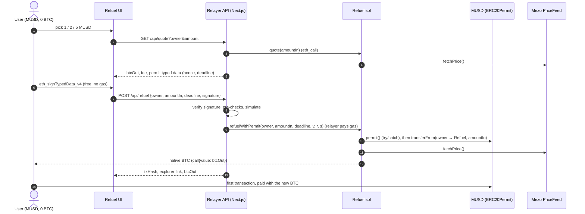

# Refuel

**Got MUSD but no BTC for gas? Sign one free permit and get enough native BTC to use Mezo.**

> **Status: testnet only.** Refuel runs on Mezo testnet (chainId 31611) with test funds. It is not deployed on mainnet. Mainnet is the first roadmap milestone below.

## The problem

On Mezo, BTC is the gas token. Wave 1 grant recipients on the buildathon page said they received tokens but had no BTC to pay gas, so they couldn't move them. The same thing happens to anyone who is sent MUSD by a friend, an app or an exchange. They hold value on Mezo but can't send a single transaction, not even an `approve`.

Refuel fixes this. The user signs an **EIP-2612 permit**, which costs no gas. A relayer submits it. The Refuel contract takes a small amount of their MUSD, prices BTC with **Mezo's own PriceFeed**, and sends native BTC to the user's wallet. One signature is enough to get the wallet working.

## How it works



`btcOut = (amountIn − fee) × 1e18 / price`, where `fee = flatFee + amountIn × feeBps / 10 000`. The defaults are a 0.05 MUSD flat fee (covers relayer gas) plus 2%. MUSD is treated as $1.

## Mezo integrations used

| Integration | How Refuel uses it |
|---|---|
| **MUSD (ERC20Permit)** | Gasless approval through EIP-2612 `permit`. The domain comes from EIP-5267 `eip712Domain()` and is checked against `DOMAIN_SEPARATOR()` before the first use. |
| **PriceFeed** | BTC/USD price for every quote and refuel. The address is found on-chain through `TroveManager.priceFeed()`, with `BorrowerOperations.priceFeed()` as a fallback, so it is never hardcoded. |
| **Native BTC gas** | Refuel holds a native BTC float and pays users with `call{value: …}`. |
| **Mezo testnet** | The contract is deployed and verified on chain 31611, and the relayer uses `rpc.test.mezo.org`. |

## Security model

- **BTC only goes to the permit signer.** `refuelWithPermit` always pays `owner`, the address that signed the permit. A relayer can't redirect the payout.
- **Pulls are capped by the permit.** The contract pulls exactly `amountIn` and requires `allowance ≥ amountIn`. A relayer can't take more than the user signed for.
- **Front-running the permit doesn't help an attacker.** The `permit` call is wrapped in `try/catch`. If someone submits the permit first, the allowance already exists and the refuel still goes through.
- **Rate limits on-chain:** a 1 MUSD to 5 MUSD range per refuel, a 24h cooldown per address, 3 refuels per address in total, and a global cap of 0.002 BTC per UTC day.
- **Oracle bounds:** the contract reverts if the price is outside $1,000 to $1,000,000, which also catches a zero or broken feed.
- **Admin controls:** the contract is `Pausable` and `Ownable2Step`, and `feeBps` has a hard cap of 10%.
- **`ReentrancyGuard`** protects `refuelWithPermit`, and the code follows checks-effects-interactions. A test checks that re-entering from `receive()` is blocked.
- **Known limits:**
  - API rate limiting (5 requests per minute per IP, 3 per hour per owner) is in-memory. Serverless instances are short-lived and don't share memory, so the on-chain cooldown and caps are the real limit.
  - The owner is trusted to set parameters and can withdraw the collected MUSD and the BTC float.
  - The relayer is a hot key holding a small gas balance.

## Addresses (Mezo testnet, chainId 31611)

| What | Address |
|---|---|
| Refuel (verified) | _pending deploy_ |
| MUSD | [`0x118917a40FAF1CD7a13dB0Ef56C86De7973Ac503`](https://explorer.test.mezo.org/address/0x118917a40FAF1CD7a13dB0Ef56C86De7973Ac503) |
| PriceFeed (resolved through TroveManager) | [`0x86bCF0841622a5dAC14A313a15f96A95421b9366`](https://explorer.test.mezo.org/address/0x86bCF0841622a5dAC14A313a15f96A95421b9366) |
| TroveManager | [`0xE47c80e8c23f6B4A1aE41c34837a0599D5D16bb0`](https://explorer.test.mezo.org/address/0xE47c80e8c23f6B4A1aE41c34837a0599D5D16bb0) |
| Relayer | _pending_ |
| Deploy block | _pending_ |

`contracts/deployments/31611.json` has the machine-readable copy.

## Run it locally

Requirements: Node 20+, pnpm, and Foundry.

```bash
git clone --recursive git@github.com:Cage4D/refuel.git && cd refuel
pnpm install
cp .env.example .env   # fill in the keys; .env is gitignored
```

| Env var | Purpose |
|---|---|
| `MEZO_RPC`, `CHAIN_ID`, `EXPLORER_URL` | Network |
| `MUSD_ADDRESS`, `TROVE_MANAGER`, `BORROWER_OPERATIONS` | Mezo contracts |
| `REFUEL_ADDRESS`, `REFUEL_DEPLOY_BLOCK` | Set these after deploying |
| `DEPLOYER_PK` | Deploys and funds the contract, and becomes its owner |
| `RELAYER_PK` | A separate hot key with about 0.001 BTC for gas |
| `DEMO_FUNDER_PK` | Holds MUSD and BTC for the demo script |
| `ALLOWED_ORIGIN`, `PERMIT_TTL_SECONDS`, `RELAYER_MIN_BALANCE_WEI` | API settings |

**Contracts**

```bash
cd contracts
forge test -vvv                                 # 25 unit tests, including fuzz
MEZO_RPC=https://rpc.test.mezo.org forge test --match-contract Fork -vv   # fork smoke test
set -a; . ../.env; set +a
forge script script/Deploy.s.sol --rpc-url $MEZO_RPC --private-key $DEPLOYER_PK --broadcast
forge script script/Fund.s.sol   --rpc-url $MEZO_RPC --private-key $DEPLOYER_PK --broadcast   # FLOAT_BTC, default 0.002
forge verify-contract <REFUEL> src/Refuel.sol:Refuel --chain-id 31611 --verifier sourcify \
  --constructor-args $(cast abi-encode "constructor(address,address)" $MUSD_ADDRESS <PRICE_FEED>)
# fallback: --verifier blockscout --verifier-url https://api.explorer.test.mezo.org/api/
```

Mezo's PriceFeed reads a native oracle precompile that Foundry's local EVM can't execute. The fork test gets the live price from the node with `eth_call` and mocks only that one call. MUSD, the permit domain and the transfers are all real.

**App and API**

```bash
pnpm abi    # copy the ABI from contracts/out into app/src/lib/abi
pnpm dev    # http://localhost:3000
```

| Endpoint | What it does |
|---|---|
| `GET /api/health` | Relayer and float balances, paused state, price |
| `GET /api/config` | Chain, contract, MUSD domain, limits, fees |
| `GET /api/quote?owner=0x…&amount=2` | Quote, eligibility, balances, and permit typed data to sign |
| `POST /api/refuel` | `{ owner, amountIn, deadline, signature }` → `{ txHash, explorerTxUrl, btcOut, status }` |
| `GET /api/refuels?limit=20` | Recent `Refueled` events |
| `GET /api/stats` | Totals and unique owners |

Errors always have the shape `{ error: { code, message, details? } }`, and each `message` can be shown to users as-is. See `app/src/lib/errors.ts`.

**Demo with fresh wallets**

```bash
pnpm dev &
pnpm demo --count 4 --amount 2          # --api https://<deployment> to target a hosted API
```

The script creates new keys and saves them to `scripts/.demo-wallets.json`, which is gitignored. It sends each new wallet MUSD only, with no BTC. Each wallet then refuels through the API and sends a follow-up transaction paid with its new BTC. The results table is added to the end of this README.

**Deploying to Vercel:** set the Root Directory to `app` and add the env vars above, except `DEPLOYER_PK` and `DEMO_FUNDER_PK`.

## Roadmap

1. **Mainnet launch** after a light audit-style review. Add monitoring of the float and relayer balances, and use a multisig as owner.
2. **MEZO support and float refill.** Accept MEZO wherever it supports EIP-2612, priced through Mezo pools with a TWAP. Add an owner-only `refill()` that swaps collected MUSD back into BTC through Mezo pools so the float tops itself up.
3. **Sponsor tanks.** Wallets and apps deposit MUSD to cover their users' fees, so onboarding a new user costs that user nothing.

## On-chain proof

<!-- demo-proof -->
